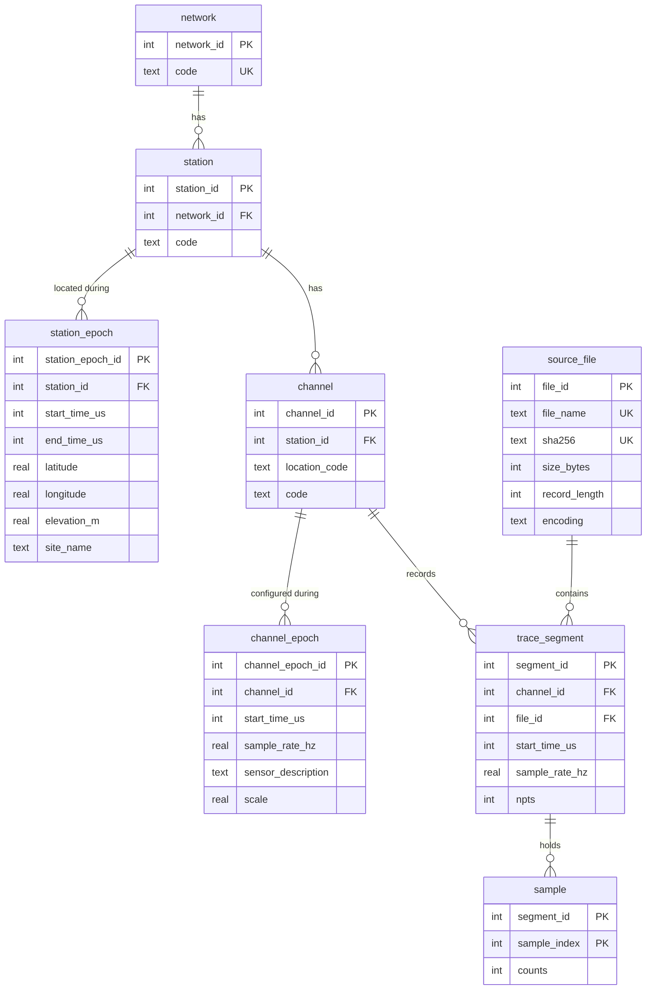

# SEP seismic pipeline

[](https://colab.research.google.com/github/dorknexus/seismic-notebook/blob/main/notebooks/sep_seismic_pipeline.ipynb)

A Google Colab notebook that imports three days of miniSEED data from Mount St. Helens crater station
**CC.SEP** (channel `EHZ`, 100 Hz), loads every sample into a normalized SQLite database, and draws a
single summary figure: title, metadata panel, 24-hour helicorders built from the database, and a map of
SEP and the nearby stations HOA and SUG located through the IRIS FDSN station service.

## Run it

1. Click **Open in Colab** above (or fork this repo and open `notebooks/sep_seismic_pipeline.ipynb` in Colab).
2. Upload `SEP01.mseed`, `SEP02.mseed` and `SEP03.mseed` from
   [CHIGHT-USGS/SeismicData](https://github.com/CHIGHT-USGS/SeismicData) through Colab's **Files** panel, into
   `/content` or `/content/data`.
3. Choose **Runtime → Run all**.

The notebook finds the files, checks each one's SHA-256, and stops with instructions if any are missing. Station
metadata comes from the [IRIS FDSN station service](http://service.iris.edu/fdsnws/station/1/). A run takes about
2–4 minutes.

Locally: put the three files in `data/`, then `pip install -r requirements.txt && jupyter notebook notebooks/sep_seismic_pipeline.ipynb`.

## What the notebook does

| Step | Detail |
|---|---|
| Import | ObsPy reads the uploaded Steim-2 miniSEED files: one UTC day each, 5–15 contiguous segments per file, about 8.6 M samples per day |
| Database | SQLite in third normal form, with primary and foreign keys, `UNIQUE` and `CHECK` constraints, a cross-table trigger, and views for derived values |
| Load | Every sample is stored as a row (25.8 M rows, about 370 MB), one transaction per file |
| IRIS metadata | Channel-level metadata for `CC.SEP.--.EHZ`; HOA and SUG searched within 1° of SEP (station codes are only unique within a network); other stations operating within about 16 km |
| Validation | `integrity_check`, `foreign_key_check`, sample-row counts against `npts`, an exact round trip from SQL back to the ObsPy arrays, and constraint checks that show the database rejecting bad rows |
| Visualization | `outputs/sep_seismic_overview.png`, plus an optional interactive Folium map |

## Database schema



Design choices:

- **Third normal form.** Each table describes one thing, and nothing derivable is stored. A segment's end time
  (`start + npts / sample_rate`) and gap lengths are computed in the views `v_segment` and `v_gap`.
- **Epoch tables** keep the station or channel *identity* separate from attributes that change over time
  (coordinates, sensor), matching the FDSN StationXML model.
- **Times** are `INTEGER` microseconds since the Unix epoch, UTC: exact, sortable and easy to compare. The views
  show them as ISO-8601 text.
- **Samples are rows**, not BLOBs, which keeps first normal form and lets SQL query the waveform directly.
  `WITHOUT ROWID` keeps the table compact.
- **Constraints:** code formats, coordinate ranges, `end > start`, `npts > 0`, valid record lengths and data-quality
  flags, unique file hashes, and a trigger that keeps `sample_index < npts`.

## Repository layout

```
.
├── notebooks/
│   └── sep_seismic_pipeline.ipynb   # the whole pipeline; runs top to bottom in Colab
├── requirements.txt                 # for running outside Colab
├── LICENSE
└── README.md
```

The input miniSEED files aren't committed: they're uploaded at runtime. `data/` and `outputs/` (database and figure)
are git-ignored, so the repository holds only code.

## Data sources

- Waveforms: [CHIGHT-USGS/SeismicData](https://github.com/CHIGHT-USGS/SeismicData), station CC.SEP
  (USGS Cascades Volcano Observatory).
- Station metadata: [IRIS / EarthScope FDSN station web service](http://service.iris.edu/fdsnws/station/1/).
- Basemap: Esri World Topographic Map tiles (static map); OpenTopoMap (interactive map).
